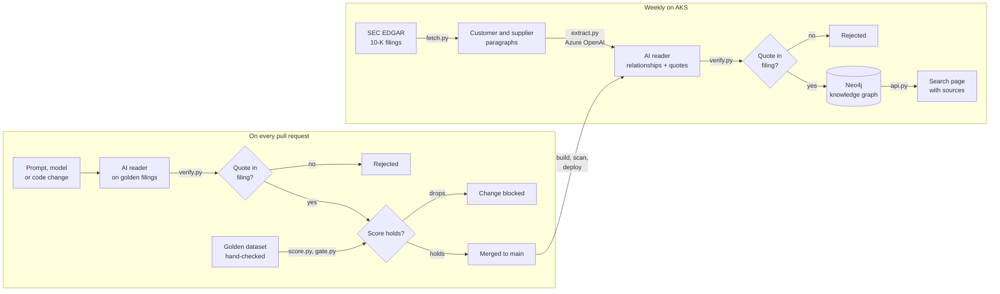
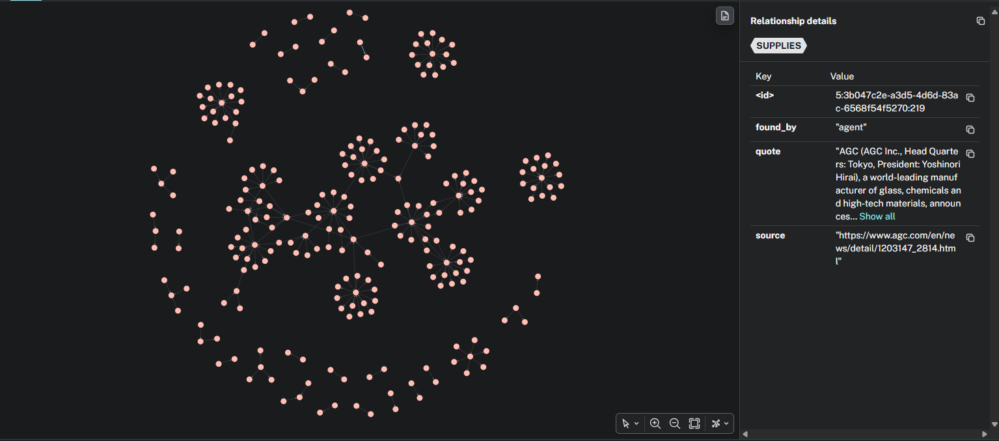

# Golden Thread

A supply-chain knowledge graph built from company filings by an AI whose answers are checked, scored and gated.

## The question

**How do you make AI-generated knowledge verifiable, measurable and maintainable as the underlying models and prompts change?**

AI can be confidently wrong, and a missed detail in financial documents can put investors at risk. So every prompt, model or code change is checked by an automated [quality gate](.github/workflows/quality-gate.yml) that answers one question: *is this AI at least as accurate as the last approved version?* Every run is recorded in [GitHub Actions](https://github.com/sss-3333/golden-thread/actions/workflows/quality-gate.yml).

## How it works

Any prompt, model or code change goes through the pull request checks first. The AI reader [extracts](app/extract.py) relationships using [this prompt](app/prompt.txt), and [verify.py](app/verify.py) rejects any quote not found in the filing. [score.py](app/score.py) scores the rest against the golden dataset, and [gate.py](app/gate.py) blocks the change if precision or recall drops below the [baseline](results/baseline.json). Once merged, the same pipeline runs [weekly on AKS](gitops/pipeline.yaml) and [loads](app/load.py) the verified relationships into Neo4j.



### Knowledge graph

<p align="center">
  
  
</p>

The site's source of truth: a map of which companies supply which, built by AI from SEC annual reports, where every link has been checked against the exact sentence and filing it came from.


## Golden dataset

The AI can't reliably grade its own work, so the answer key comes from a person. I labelled 5 filings by hand, before looking at the AI's output, following written [rules](golden/RULES.md) and using a small [review tool](app/review.py). Here's an [example](golden/1045810.json). In production this would be done by domain experts, on more filings.

## Findings

| Precision | Recall | Duplicates |
|:---:|:---:|:---:|
| **100%** | **97%** (64 of 66) | **1** |

- **[Key findings](results/EXPERIMENTS.md#key-findings):** the AI was confidently wrong, so it couldn't be relied on to flag its own mistakes
- **[Prompt comparison](results/EXPERIMENTS.md#prompt-comparison):** a deliberately vague prompt dropped recall to 30%, and the gate [blocked the PR](https://github.com/sss-3333/golden-thread/pull/2/checks)
- **[Model comparison](results/EXPERIMENTS.md#model-comparison):** a bigger model gained one relationship at about 5 times the cost, and the cheapest was unreliable


## Platform
AI Ouput Measured ✅ ➡️ Ensure it could run on secure, consistent and repeatable infra. 

Golden Thread runs on my existing [AKS platform](https://github.com/sss-3333/trackance-aks) as a second app, rather than its own cluster. The cluster is built with [Terraform](https://github.com/sss-3333/trackance-aks/blob/main/infra/modules/aks/main.tf) and deployed with GitOps through ArgoCD's [app of apps](https://github.com/sss-3333/trackance-aks/blob/main/gitops/root.yaml) pattern.

Golden Thread brings only its own pieces: a namespace, [its Kubernetes files](gitops/), an Azure identity and [one ArgoCD entry](https://github.com/sss-3333/trackance-aks/blob/main/gitops/apps/golden-thread.yaml).

Everything shared is already on the platform, so Golden Thread gets it with no setup:

- **HTTPS:** [cert-manager](https://github.com/sss-3333/trackance-aks/blob/main/gitops/apps/cert-manager.yaml) with a [Let's Encrypt issuer](https://github.com/sss-3333/trackance-aks/blob/main/gitops/issuers/letsencrypt.yaml)
- **DNS:** [ExternalDNS](https://github.com/sss-3333/trackance-aks/blob/main/gitops/apps/external-dns.yaml)
- **Traffic:** [ingress-nginx](https://github.com/sss-3333/trackance-aks/blob/main/gitops/apps/ingress-nginx.yaml)
- **Monitoring:** [Prometheus and Grafana](https://github.com/sss-3333/trackance-aks/blob/main/gitops/apps/monitoring.yaml), for health and resource use. See the [dashboards](results/EXPERIMENTS.md#dashboards)

### Tradeoff
- sharing cluster resources and dependencies = shared failure could affect both!
- To avoid, in production, I'd introduce stronger isolation through resource quotas, network policies and separate Argo CD projects.

## Deployments

From [gitops/api.yaml](gitops/api.yaml):

- API runs with twp replicas and rolling updates, so new pods only receive traffic one their **readiness** checks pass.
- **Liveness** checks restart stuck containers, and becuase ArgoCD manages the desired state from Git, rollback is a Git Revert

### Subdomain

The site lives at [golden-thread.labs.trackance.co.uk](https://golden-thread.labs.trackance.co.uk) (live while the platform is running). ExternalDNS creates the address and cert-manager the certificate, both from [one ingress](gitops/api.yaml).


## CI/CD, Security and operations

- **Every change through a pull request:** main is what gets built and deployed, so it's protected. Nothing merges without passing the quality gate and the image scan, as this [blocked PR](https://github.com/sss-3333/golden-thread/pull/2) shows
- **Scanned images:** every build is [scanned with Trivy](.github/workflows/build.yml) before it can be published
- Once nerged, the image is published to Azure Container Registry, and Argo CD handles deployment to AKS
- **No API keys:** GitHub Actions authenticates to Azure using OIDC, and the pipeline running inside Kubernetes uses Azure Workload Identity, so neither needs stored Azure credentials. [workload identity](infra/pipeline.tf)
- Cluster access is managed through Entra ID
- **Private database:** users only reach Neo4j through the API's fixed, parameterised queries
- For monitoring, the platform already collects resource usage, pod restarts and job status through Prometheus and Grafana. Alertmanager notifications aren't configured yet, so that's one operational improvement I'd make.
- Once a change is deployed, a weekly Kubernetes CronJob processes filings and updates the knowledge graph."
- **HTTPS everywhere public:** the site uses a free Let's Encrypt certificate, issued and renewed automatically by the platform's cert-manager


## Bringing it live

To keep costs down, I destroy the platform between sessions. Bringing it back is the platform's [Terraform Apply](https://github.com/sss-3333/trackance-aks/actions), Terraform recreates the infrastructure, and Argo CD restores the applications from Git.

Three steps for Golden Thread:
- re-link the pipeline's [identity](infra/pipeline.tf) to the new cluster
- recreate the two Kubernetes secrets
- run the pipeline job once to fill the graph. ArgoCD redeploys everything else from [gitops/](gitops/).

To automate it: 
- move the identity link into the platform's Terraform
- keep the secrets in Azure Key Vault
- add a job that automatically repopulates the graph after each deploy.

## Design choices

### Infrastructure

| Choice | Why | Trade-off |
|---|---|---|
| **Reusing an existing AKS platform** | Golden Thread brings only its own pieces: a namespace, its Kubernetes files, an identity and one ArgoCD entry. DNS and HTTPS come from the platform automatically, under its subdomain. In most organisations a shared platform runs many apps like this | I destroy the platform between sessions to save cost, so one apply brings every app back up, including Trackance. A shared cluster in production would also need per-team guardrails: resource quotas, network policies and a separate ArgoCD project |
| **Quality gate on every PR** | Any change that lowers precision or recall below the baseline can't merge. The baseline only moves through a reviewed PR | Each PR costs a few pence in AI calls. Scores vary slightly between runs, so the gate measures rather than guarantees |
| **Monitoring from the platform** | Golden Thread gets Prometheus and Grafana from the platform with no setup: pod CPU, memory, restarts and job status are collected automatically | Alertmanager is off on the platform, so alerts show in Grafana but aren't sent anywhere yet |
| **Shared platform layers, reused by every app** | The platform is built once, in layers: Terraform for the cluster, registry and identities, and ArgoCD for the shared add-ons (cert-manager for HTTPS, ExternalDNS for DNS, ingress, Prometheus and Grafana), each from a pinned Helm chart. Any app on the cluster gets HTTPS, DNS, monitoring and a registry by adding its own files, without changing the platform. Golden Thread needed one ingress file for a public HTTPS address | All apps share the same versions of these add-ons, so upgrading one (for example cert-manager) affects every app and has to be tested across all of them |
| **Safe rolling updates** | A new API version only receives traffic once its readiness check passes, and the old pods stay up until then | No canary stage: a bad version that passes its health check still reaches all users |
| **Self-healing** | Liveness checks restart a stuck API, 2 replicas keep it up during restarts, and ArgoCD undoes any manual change to the cluster | Changes must go through Git, even in an emergency |
| **Cluster access through Entra ID only** | Local Kubernetes accounts are disabled, so every engineer signs in with their Azure identity and permissions | Needs Azure access set up for each engineer |
| **Every change through a pull request** | Main is what gets built and deployed, so it's protected: nothing merges without passing the quality gate and the image scan. Main is always releasable, and every change has a record of its checks | Slower for small changes like docs, and each PR costs a few pence in AI calls. As a solo project there's no second reviewer; in a team I'd also require an approval |
| **Scan on every PR, publish only from main** | Vulnerabilities block the merge, and only reviewed code becomes an image | The base image is patched at build time, so builds can differ slightly day to day. Distroless would reduce this but doesn't ship Python 3.12 |
| **Weekly CronJobs** | Keeps it simple and rebuilds the graph regularly | Since 10-Ks are annual, in production I'd trigger it on new filings instead, the way the alerts job already watches for 8-Ks |
| **Neo4j private, API with fixed queries** | Users only reach the graph through fixed, parameterised queries, never the database itself | The free Neo4j edition has no read-only users, so the protection is in the API |

### Application

| Choice | Why | Trade-off |
|---|---|---|
| **Golden dataset labelled by hand** | The AI can't reliably grade itself, so the answer key comes from a person. I labelled 5 filings before seeing the AI's output, so its answers couldn't influence mine | 5 filings give a rough score, not a guarantee. In production this needs domain experts and two labellers per filing |
| **The graph is rebuildable** | Neo4j's contents come from files in Git, so re-running the pipeline recreates the graph after any loss | Recovery means a pipeline run (a few minutes and pennies in AI calls) rather than restoring a backup |
| **Alerts without AI** | Events come straight from the SEC and affected companies from the verified graph, so alerts add no new accuracy risk | Limited to companies with SEC filings |
| **Shared name rules** | Scoring and the graph use the same rules to match company names, so "TSMC" and "Taiwan Semiconductor" are one company in both | The alias list is maintained by hand |
| **Every relationship must quote its source** | A quote that isn't in the filing is rejected, so nothing reaches the graph without evidence | Catches invented relationships, not wrong ones with a real quote. That's what the golden dataset is for |

## Azure resources (Terraform)

All Azure resources are defined in Terraform in [infra/](infra/), as a few plain files rather than modules, since each is only built once:

- **Azure OpenAI** account and a `gpt-4.1-mini` deployment, pinned to version `2025-04-14` with auto-upgrade off, so the model only changes through a reviewed PR
- **GitHub login** identity with OIDC, limited to this repo's main branch and pull requests, with access to the AI account only

## Limitations

- Filings only name major customers and suppliers, and some hide them as "Customer A"
- Customers are disclosed more reliably than suppliers
- 5 golden filings give a rough score, not a guarantee

## Run it locally

Prerequisites: Docker, an Azure login with access to the AI account (`az login`), and the `NEO4J_*` settings.

```bash
docker run -d --name neo4j -p 127.0.0.1:7474:7474 -p 127.0.0.1:7687:7687 -e NEO4J_AUTH=neo4j/$NEO4J_PASSWORD neo4j:5.26
pip install -r requirements.txt
python app/extract.py && python app/verify.py && python app/score.py
python app/load.py
uvicorn api:app --app-dir app
```

Then open http://localhost:8000.

## Additional service: Web investigator

An agent that extends the graph beyond SEC filings, by researching companies across the web and following the supply chain hop by hop. Built at the Agentic Web build night (Parallel x No Agenda).

[agent.py](app/agent.py) gives a company to Parallel's [Task API](https://docs.parallel.ai/task-api/task-quickstart), which researches it across the web and returns relationships with an exact quote and source URL. Every claim then goes through the same rule as the main pipeline: the page is fetched with Parallel's Extract API, and the claim is rejected unless the quote is on it. Verified links go into Neo4j, and the companies found are researched in the next hop.

- **Many sources per company:** the main pipeline reads one filing per company; the agent reads filings, press releases and news
- **Connects the dots:** no single source links ASML to Apple, but the verified links from different sources join into a path
- **Same name rules:** links use the shared `key()` rules, so the same company from different sites becomes one node
- **Capped:** 3 hops and 10 companies per hop, so a run costs well under $1

| Sources cited | Links verified | Rejected |
|:---:|:---:|:---:|
| [number] | [number] | [number] |



## Status

- [x] Fetch filings from SEC EDGAR
- [x] AI reader with quoted sources
- [x] Quote verification
- [x] Golden dataset
- [x] Quality gate in CI
- [x] Model comparison
- [x] Neo4j graph
- [x] Terraform for the Azure AI setup
- [x] Platform on AKS with GitOps
- [x] Live alerts
- [x] Additional: Web Investigator with Parallel
