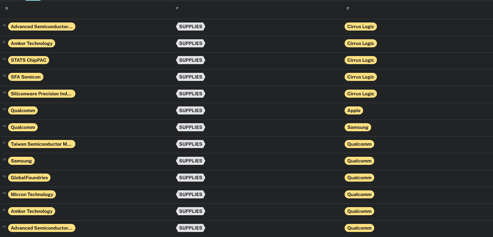
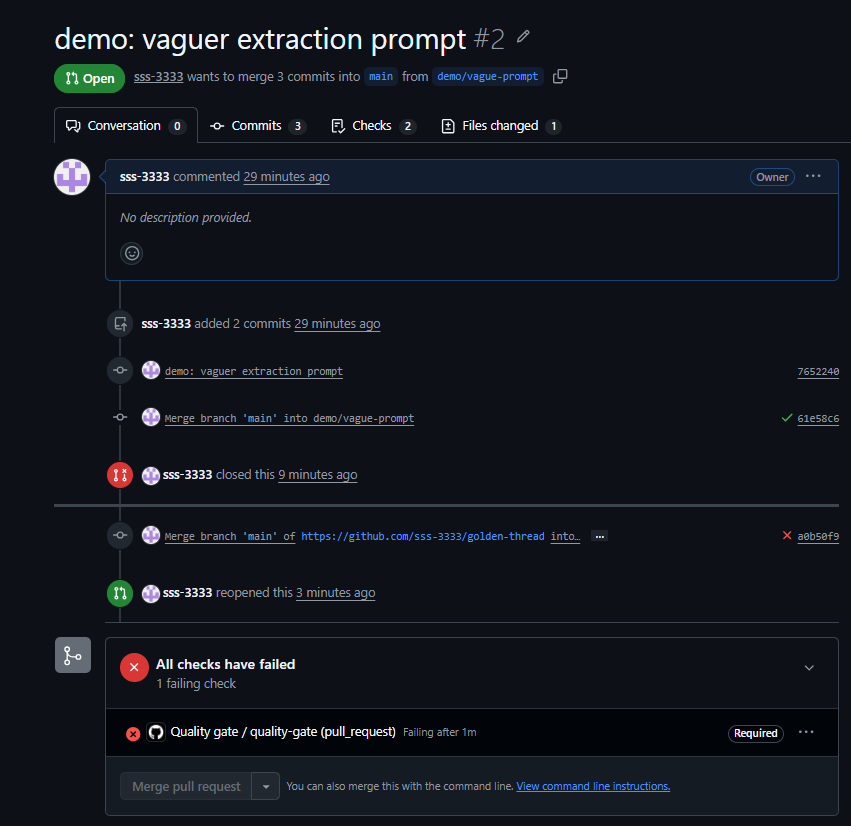
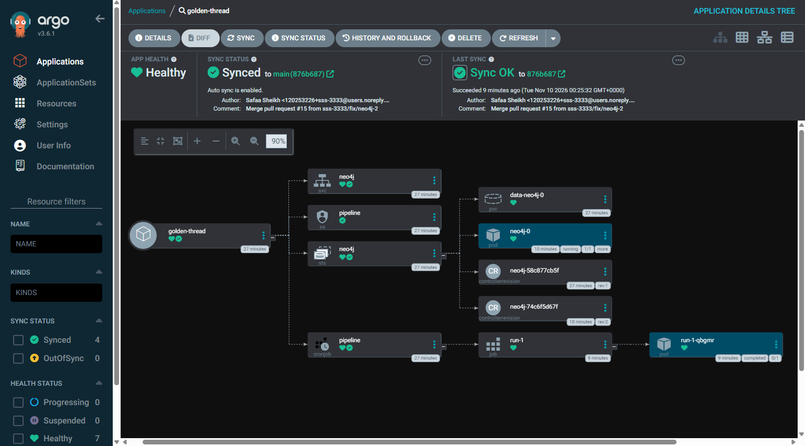

# Golden Thread

A supply-chain knowledge graph built from company filings by an AI whose answers are checked, scored and gated.

## The question
**How do you make AI-generated knowledge verifiable, measurable and maintainable as the underlying models and prompts change?**

## Knowledge Graph

<p align="center">
  
  
</p>

## Every answer has a source



## How it works


| | How |
|---|---|
| **Verifiable** | Every relationship keeps the exact quote and filing link it came from. Quotes not found in the filing are rejected |
| **Measurable** | Scored against a hand-checked [golden dataset](golden/RULES.md) |
| **Maintainable** | A prompt or model change that lowers the score is blocked in CI |

## Approach: golden dataset

The AI can't reliably grade its own work, so the answer key comes from a person. I labelled 5 filings by hand, before looking at the AI's output, following written [rules](golden/RULES.md). Every change is scored against them.

## Results

| Precision | Recall | Duplicates |
|:---:|:---:|:---:|
| **100%** | **97%** (64 of 66) | **1** |

A deliberately vaguer prompt dropped the score, and the quality gate blocked the PR:



Version history, error types and findings: [results/EXPERIMENTS.md](results/EXPERIMENTS.md)

## Security

- **No API keys:** GitHub Actions signs in to Azure with OIDC, and the app uses Entra ID
- **Untrusted input:** the AI's output is checked against the source filing, not trusted

## Infrastructure

All Azure resources are defined in Terraform in [infra/](infra/):

- **Azure OpenAI** account and a `gpt-4.1-mini` deployment, pinned to version `2025-04-14` with auto-upgrade off, so the model only changes through a reviewed PR
- **GitHub login** identity with OIDC, limited to this repo's main branch and pull requests, with access to the AI account only

## Platform

Runs on my existing [AKS platform](https://github.com/sss-3333/trackance-aks) as a second app:

- **Image** built, scanned with Trivy and pushed to the platform's ACR on every merge to main
- **Deployed** by the platform's ArgoCD from [gitops/](gitops/)
- **Pipeline** runs as a weekly CronJob and logs in to Azure with workload identity, so no keys
- **Neo4j** has a private cluster address only, with memory limits and its own disk



## Run it

```bash
cd infra && terraform init && terraform apply && cd ..
pip install -r requirements.txt
python app/extract.py && python app/verify.py && python app/score.py
python app/load.py
```

## Limitations

- Filings only name major customers and suppliers, and some hide them as "Customer A"
- Customers are disclosed more reliably than suppliers
- 5 golden filings give a rough score, not a guarantee

## Status

- [x] Fetch filings from SEC EDGAR
- [x] AI reader with quoted sources
- [x] Quote verification
- [x] Golden dataset
- [x] Quality gate in CI
- [x] Neo4j graph
- [x] Terraform for the Azure AI setup
- [ ] Platform on AKS with GitOps
- [ ] One-command local setup