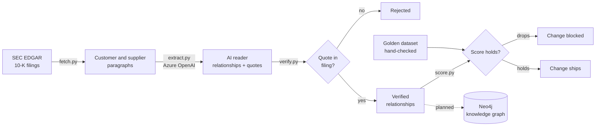

# Golden Thread

A traceable, checked AI pipeline that builds a supply-chain knowledge graph from company filings.

## The question this project answers

**How do you make AI-generated knowledge verifiable, measurable and maintainable as the underlying models and prompts change?**

AI tools that read documents can quietly get less accurate when someone changes a prompt or model, and the output still looks confident, so nobody notices until it matters.

## What this project focuses on

Most AI extraction demos stop at "the AI returned an answer". This project focuses on what happens after:

- **Verifiable:** every relationship carries the exact quote it came from, and quotes that don't appear in the source are rejected automatically.
- **Measurable:** accuracy and consistency are scored against a human-checked golden dataset.
- **Maintainable:** any prompt or model change that lowers those scores is blocked in CI, so quality doesn't silently drift.

## How it works



## Reusability

| Area | How |
|---|---|
| **Environments** | One Terraform module and one GitOps folder. A new environment is a small settings file, not custom code |
| **Releases** | Every change goes through the same pipeline: build, scan, quality gate, then GitOps |
| **Builds** | Pinned packages, base images pinned by digest, pinned Helm charts and Terraform providers |
| **AI behaviour** | Pinned model version, prompt versioned in Git, consistency measured on every change |
| **Recovery** | A rebuild drill recreates the platform from code and re-runs the checks |

## Security

- **No stored cloud credentials:** GitHub Actions logs in to Azure with OIDC.
- **Secrets kept out of code:** the AI provider key is stored as a secret, never in Git.
- **Scanned builds:** Trivy scans every image, and Checkov scans the Terraform.
- **Untrusted input:** filings are external text, so the AI's output is verified against the source rather than trusted.

## Platform

- **Infrastructure:** AKS, built with Terraform, reusing my own platform code
- **Deployment:** GitOps with ArgoCD
- **CI:** image builds, security scanning, and the quality gate
- **Storage:** Neo4j, with backups
- **Scheduled jobs:** filing collection
- **Monitoring:** Prometheus and Grafana for health, alerts, and AI cost per filing

## Rebuild from code

The whole platform can be torn down and rebuilt from code, with no manual steps in between.

To rebuild: run **Actions → Terraform Destroy**, then **Actions → Terraform Apply**.

**On your own machine**

The same platform runs locally on kind (Kubernetes in Docker), using the same GitOps setup as the cloud version. Requires Docker, kind, kubectl and make.

```bash
git clone https://github.com/sss-3333/golden-thread.git
cd golden-thread
make up
```

To remove it all:

```bash
make down
```
## Golden dataset: keeping a human in the loop

The quality gate is automated, but it depends on one thing only a person can provide: **a definition of what "correct" looks like.**

An AI can't reliably grade its own work. The human effort is small and targeted, following written rules. The rules, the labelling process, the answer format and how this would work in production are all in [golden/RULES.md](golden/RULES.md).

### How the dataset is reused on every change: 

- **A small set of filings (starting with 5),** where I read the supplier and customer sections myself and wrote down every relationship **before** looking at the AI's output, so its answers couldn't influence mine.
- **Accuracy:** how many of the AI's relationships match the hand-checked answers, how many it invented, and how many it missed.
- **Consistency:** each golden filing is run 3 times, to measure how often the AI returns the same relationships.

## Limitations

- Filings only name major customers and suppliers, so the graph shows significant relationships, not every one.
- Filings are much more reliable for customer relationships than supplier ones. Companies must name customers that make up a large share of their revenue, but there's no equivalent rule for suppliers.
- Some companies don't name major customers at all, and refer to them as "Customer A" or similar. These can't be added to the graph.
- A small golden dataset gives a rough score, not a guarantee across all filings.
- LLMs aren't fully deterministic even with a pinned model, so consistency is measured rather than guaranteed.
- The finance logic is deliberately simple. The focus is the reliability, traceability and trust around the AI.

## Results

| Precision | Recall | Duplicates |
|:---:|:---:|:---:|
| **100%** | **97%** (64 of 66) | **1** |

The full version history, the three kinds of error, and how they answer the core question are in [results/EXPERIMENTS.md](results/EXPERIMENTS.md).

### The gate in action

A pull request with a vaguer prompt, [blocked by the quality gate](https://github.com/sss-3333/golden-thread/pull/2). Precision fell to 90% and recall to 82%, so the change couldn't be merged.


## Next steps

- A review queue, so a person can approve new relationships before they enter the graph
- Live event alerts from the SEC's 8-K feed, flagging affected companies
- An AI assistant over the graph through MCP, optionally connected to Copilot Studio
- A web view of the graph

## Status

- [ ] Fetch filings from SEC EDGAR
- [ ] AI reader with quoted sources
- [ ] Quote verification
- [ ] Golden dataset
- [ ] Quality gate in CI (accuracy and consistency)
- [ ] Neo4j graph
- [ ] Pinned builds and environment template
- [ ] Platform on AKS with GitOps
- [ ] Monitoring and AI cost tracking
- [ ] Rebuild drill