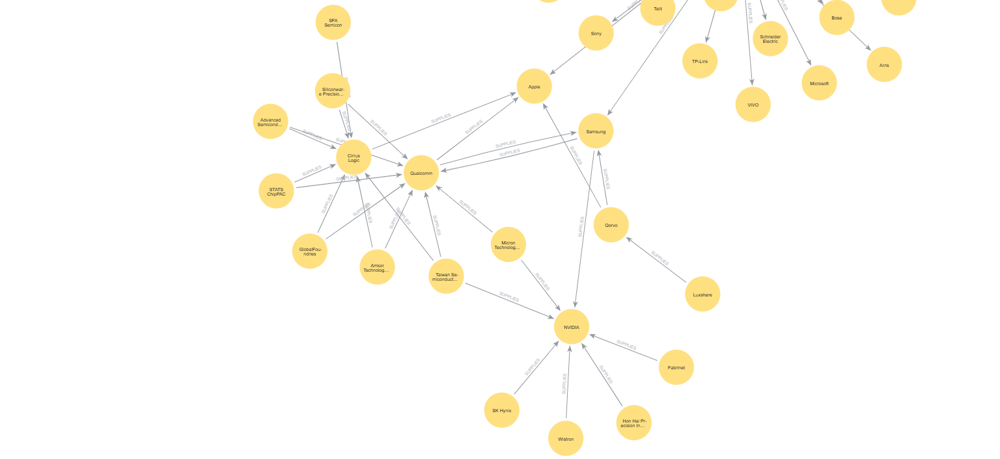
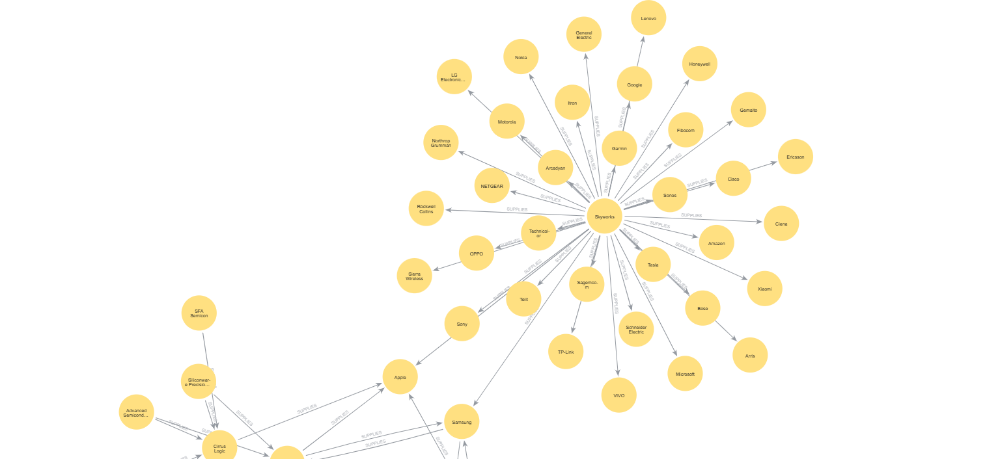
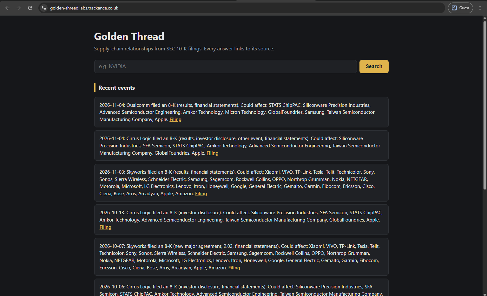
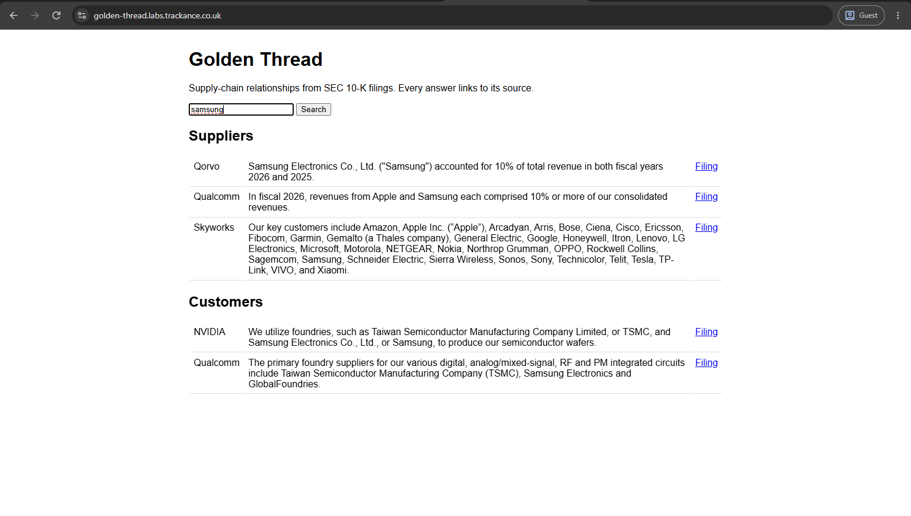
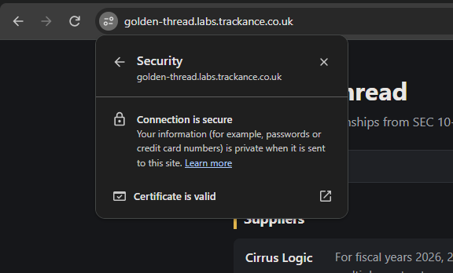

# Golden Thread

A supply-chain knowledge graph built from company filings by an AI whose answers are checked, scored and gated.

## The question
**How do you make AI-generated knowledge verifiable, measurable and maintainable as the underlying models and prompts change?**

## How it works


## Knowledge Graph

<p align="center">
  
  
</p>

The site’s source of truth: a map of which companies supply which, built by AI from SEC annual reports, where every link has been checked against the exact sentence and filing it came from.

## Design choices

| Choice | Why | Trade-off |
|---|---|---|
| **Golden dataset labelled by hand** | The AI can't reliably grade itself, so the answer key comes from a person. I labelled 5 filings before seeing the AI's output, so its answers couldn't influence mine | 5 filings give a rough score, not a guarantee. In production this needs domain experts and two labellers per filing |
| **Reusing an existing AKS platform** | Golden Thread brings only its own pieces: a namespace, its Kubernetes files, an identity and one ArgoCD entry. DNS and HTTPS come from the platform automatically, under its subdomain. In most organisations a shared platform runs many apps like this | I destroy the platform between sessions to save cost, so one apply brings every app back up, including Trackance. A shared cluster in production would also need per-team guardrails: resource quotas, network policies and a separate ArgoCD project |
| **Every relationship must quote its source** | A quote that isn't in the filing is rejected, so nothing reaches the graph without evidence | Catches invented relationships, not wrong ones with a real quote. That's what the golden dataset is for |
| **Quality gate on every PR** | Any change that lowers precision or recall below the baseline can't merge. The baseline only moves through a reviewed PR | Each PR costs a few pence in AI calls. Scores vary slightly between runs, so the gate measures rather than guarantees |
| **Model pinned in Terraform** | Auto-upgrade is off, so the model only changes through a PR and the gate, the same as a prompt change | Newer model versions have to be adopted deliberately |
| **Monitoring from the platform** | Golden Thread gets Prometheus and Grafana from the platform with no setup: pod CPU, memory, restarts and job status are collected automatically | Alertmanager is off on the platform, so alerts show in Grafana but aren't sent anywhere yet |
| **Shared platform layers, reused by every app** | The platform is built once, in layers: Terraform for the cluster, registry and identities, and ArgoCD for the shared add-ons (cert-manager for HTTPS, ExternalDNS for DNS, ingress, Prometheus and Grafana), each from a pinned Helm chart. Any app on the cluster gets HTTPS, DNS, monitoring and a registry by adding its own files, without changing the platform. Golden Thread needed one ingress file for a public HTTPS address | All apps share the same versions of these add-ons, so upgrading one (for example cert-manager) affects every app and has to be tested across all of them |
| **Safe rolling updates** | A new API version only receives traffic once its readiness check passes, and the old pods stay up until then | No canary stage: a bad version that passes its health check still reaches all users |
| **Self-healing** | Liveness checks restart a stuck API, 2 replicas keep it up during restarts, and ArgoCD undoes any manual change to the cluster | Changes must go through Git, even in an emergency |
| **Cluster access through Entra ID only** | Local Kubernetes accounts are disabled, so every engineer signs in with their Azure identity and permissions | Needs Azure access set up for each engineer |
| **The graph is rebuildable** | Neo4j's contents come from files in Git, so re-running the pipeline recreates the graph after any loss | Recovery means a pipeline run (a few minutes and pennies in AI calls) rather than restoring a backup |
| **Scan on every PR, publish only from main** | Vulnerabilities block the merge, and only reviewed code becomes an image | The base image is patched at build time, so builds can differ slightly day to day. Distroless would reduce this but doesn't ship Python 3.12 |
| **Neo4j private, API with fixed queries** | Users only reach the graph through fixed, parameterised queries, never the database itself | The free Neo4j edition has no read-only users, so the protection is in the API |
| **Alerts without AI** | Events come straight from the SEC and affected companies from the verified graph, so alerts add no new accuracy risk | Limited to companies with SEC filings |
| **Shared name rules** | Scoring and the graph use the same rules to match company names, so "TSMC" and "Taiwan Semiconductor" are one company in both | The alias list is maintained by hand |


## Platform

Runs on my existing AKS platform as a second app, at [golden-thread.labs.trackance.co.uk](https://golden-thread.labs.trackance.co.uk) (live while the platform is running).





- **Image** built, scanned with Trivy and pushed to the platform's ACR on every merge to main
- **Deployed** by the platform's ArgoCD from [gitops/](gitops/)
- **Pipeline** runs as a weekly CronJob and logs in to Azure with workload identity, so no keys
- **Iac** Terraform is a few plain files describing its own Azure resources rather than modularised 
- **API** serves the search page with 2 replicas, health checks, HTTPS and rate limiting, using fixed read-only queries
- **Neo4j** has a private cluster address only, with memory limits and its own disk
- **Alerts** check the SEC hourly for new 8-K filings and show which suppliers and customers could be affected, with no AI involved

## Security

- **No API keys:** GitHub Actions signs in to Azure with OIDC, and the app uses Entra ID
- **Untrusted input:** the AI's output is checked against the source filing, not trusted
- **HTTPS everywhere public:** the site uses a free Let's Encrypt certificate, issued and renewed automatically by the platform's cert-manager



## Infrastructure

All Azure resources are defined in Terraform in [infra/](infra/):

- **Azure OpenAI** account and a `gpt-4.1-mini` deployment, pinned to version `2025-04-14` with auto-upgrade off, so the model only changes through a reviewed PR
- **GitHub login** identity with OIDC, limited to this repo's main branch and pull requests, with access to the AI account only


## Run it

```bash
cd infra && terraform init && terraform apply && cd ..
pip install -r requirements.txt
python app/extract.py && python app/verify.py && python app/score.py
python app/load.py
```

## Limitations

- Filings only name major customers and suppliers, and some hide them as "Customer A"
- Customers are disclosed more reliably than suppliers
- 5 golden filings give a rough score, not a guarantee

## Status

- [x] Fetch filings from SEC EDGAR
- [x] AI reader with quoted sources
- [x] Quote verification
- [x] Golden dataset
- [x] Quality gate in CI
- [x] Model Comparison
- [x] Neo4j graph
- [x] Terraform for the Azure AI setup
- [x] Platform on AKS with GitOps
- [x] Live Alerts
