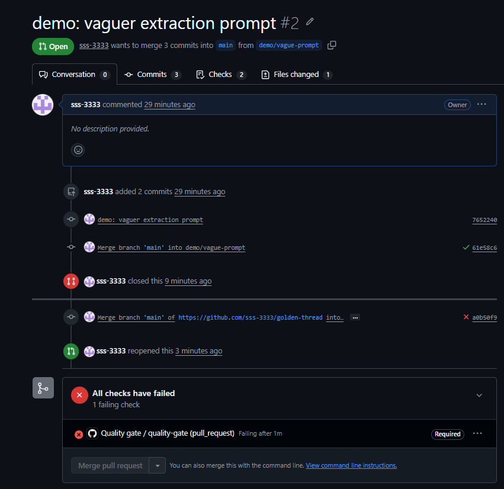
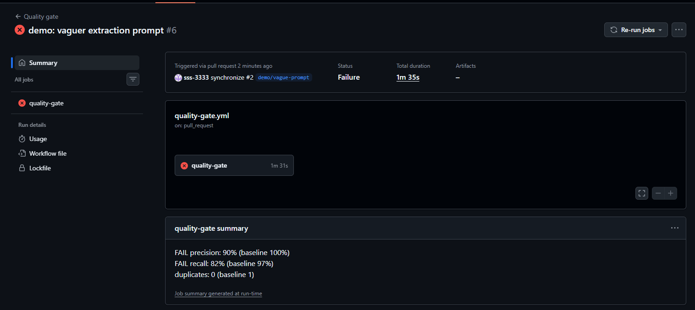
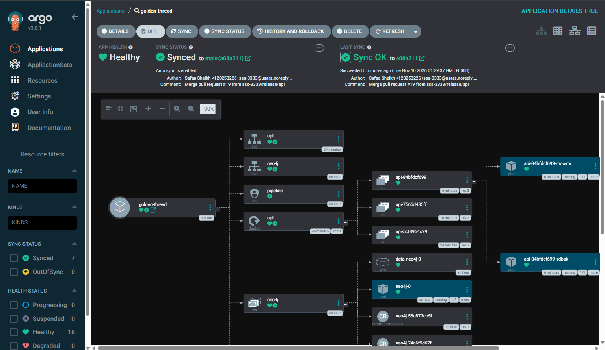
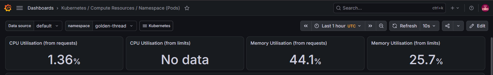
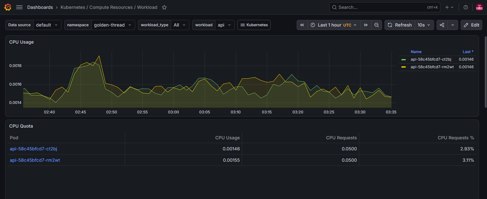
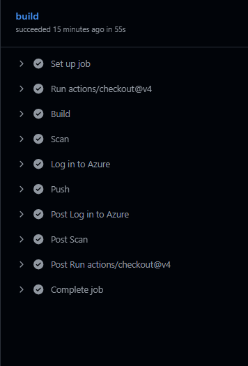
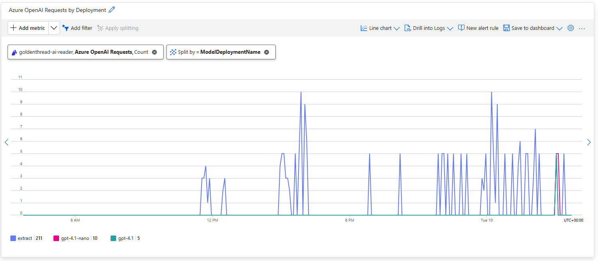

# Findings

**The question:** how do you make AI-generated knowledge verifiable, measurable and maintainable as models and prompts change?

**Setup:** 5 SEC 10-K filings · 66 hand-checked relationships · `gpt-4.1-mini` on Azure OpenAI · temperature 0

---

## Baseline

| Precision | Recall | Duplicates |
|:---:|:---:|:---:|
| **100%** | **97%** (64 of 66) | **1** |

---

## Model comparison

Same prompt, same 5 golden filings, same scoring. Each model pinned to a version in Terraform.

| Model | Precision | Recall | Quotes rejected | List price vs production |
|---|:---:|:---:|:---:|:---:|
| `gpt-4.1-mini` (production) | **100%** | **97%** | 0 | 1x |
| `gpt-4.1` | 100% | 98% | 0 | about 5x |
| `gpt-4.1-nano`, run 1 | failed | failed | n/a | about 0.25x |
| `gpt-4.1-nano`, run 2 | 84% | 80% | 14 | about 0.25x |

`gpt-4o-mini` was also planned, but Azure no longer allows new deployments of it because it's being retired.

1. **A bigger model is probably worth it.** `gpt-4.1` found one more relationship, at about five times the price.
2. **The cheapest model wasn't reliable.** Run 1 broke the output format and stopped the pipeline. Run 2 finished but invented relationships and misquoted sentences.
3. **The quote check earned its place.** It rejected 14 of nano's quotes that weren't in the filings. The production model had none rejected.
4. **Models retire.** Pinning a version stops surprise changes, but a forced upgrade will come. When it does, the replacement gets scored against the same golden dataset before it ships.

---

## Prompt comparison

Same model, same 5 golden filings, same scoring. Only the prompt changed.

| Prompt | Precision | Recall | Gate |
|---|:---:|:---:|:---:|
| Production prompt | **100%** | **97%** | Pass |
| Production prompt without the "Do NOT include" list | 100% | 97% | Pass |
| Vague prompt, CI run | 90% | 82% | **Fail** |

The vague prompt was: *"List the companies that {company} works with"*, with no definitions, naming rule or quoting rule.

1. **A vague prompt hurt recall most.** The AI still found some real relationships, but missed most of them, because nothing told it what counts as a customer or supplier.
2. **The gate blocked it.** I opened it as [pull request #2](https://github.com/sss-3333/golden-thread/pull/2), the quality gate failed both checks, and it couldn't merge. The PR is kept closed as evidence.
3. **Not every rule in a prompt matters.** Removing the exclusion list changed one line of output and no score, so the definitions and quoting rule are doing the work.

---

## Version history

| Version | Change | Precision | Recall | Duplicates |
|---|---|---|---|:---:|
| **v1** | First prompt, first golden set | `████████░░` 84% | `███████░░░` 78% | 10 |
| **v2** | Golden set: added 5 Cirrus Logic suppliers I'd missed | `█████████░` 93% | `████████░░` 80% | 10 |
| **v3** | **Prompt:** AI no longer returns the filing company | `█████████░` 92% | `█████████░` 91% | 1 |
| **v4** | Golden set: Micron added, names standardised, alternative names in scoring | `██████████` 100% | `██████████` 97% | 1 |

- **v1 → v2 and v3 → v4** fixed the **test**.
- **v2 → v3** improved the **AI**. One prompt change took Qualcomm from **0 to 7 matched** and duplicates from **10 to 1**.

---

## Key findings

1. **AI is confidently wrong.** The swapped Qualcomm relationships looked as certain as the correct ones. The AI never flagged a mistake.
2. **One check isn't enough.** The quote check passed all 10 swapped relationships, because the quotes were real. Only the golden comparison caught them.
3. **Errors depend on the input.** The same prompt worked on NVIDIA and failed on Qualcomm. Testing on one or two files would have missed it.
4. **Results vary between runs.** The vague prompt scored 80/30 locally and 90/82 in CI. Nano failed once and finished once. One good run isn't proof, so scores are measured on every change.
5. **The test can be wrong too.** The AI found 6 relationships I'd missed. The golden set needs a fair correction process, not blind trust.
6. **97% recall isn't enough.** Both misses were significant: **Xiaomi** (Qualcomm customer) and the **US Government** (Qorvo customer). Both sentences were sent to the AI, so these are AI misses, not filter misses.

---

## How this answers the question

| | How | Evidence |
|---|---|---|
| **Verifiable** | Every relationship carries an exact quote, checked against the filing | Quotes not in the filing are rejected before reaching the graph (14 from nano) |
| **Measurable** | Precision, recall and duplicates against a human-checked golden set | Four versions, three models and four prompts scored the same way |
| **Maintainable** | Every prompt or model change is re-scored before it ships | The vague prompt was blocked, and the v3 prompt fix was measured, not guessed |

---

## Reproduce

- `git checkout v1`: the first AI reader, before any fixes
- `git checkout v4-baseline`: the code and golden data behind the 100% / 97% baseline

v2 and v3 were made between these two tags, mixed in with other commits, so they aren't tagged separately. Scores can vary slightly between runs (see key finding 4).

**Limits:** 5 filings and three models from one provider, so these scores catch regressions rather than guarantee accuracy at scale.

## Dashboards

| Screenshot | What it shows |
|---|---|
|  | **ArgoCD:** Golden Thread deployed from Git, with every piece (API, Neo4j, both CronJobs) synced and healthy |
|  | **Grafana, Golden Thread namespace:** CPU and memory of every pod against its limits, showing Neo4j stays within its caps |
|  | **Grafana, API workload:** both API replicas running, with their resource use |
|  | **GitHub Actions, quality gate:** the precision and recall check that runs on every pull request |
|  | **GitHub Actions, build:** build, Trivy scan and push to the platform's registry |
|  | **Azure OpenAI deployments:** each model pinned to an exact version, managed by Terraform |

## Next

- **Critical relationships:** flag major customers and sole suppliers in the golden set, and fail the gate if any are missed, whatever the average
- **Held-out set:** extra filings never used for tuning, to check improvements aren't tailored to these 5
- **Another provider:** run a non-OpenAI model through the same golden set to compare accuracy and cost